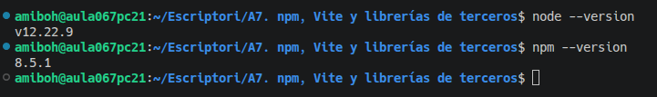
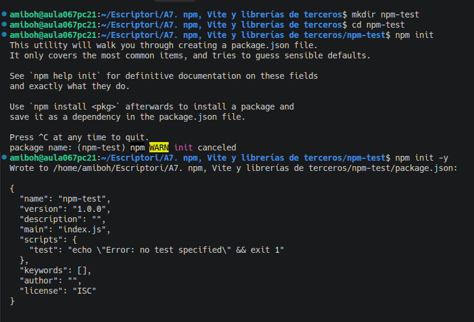
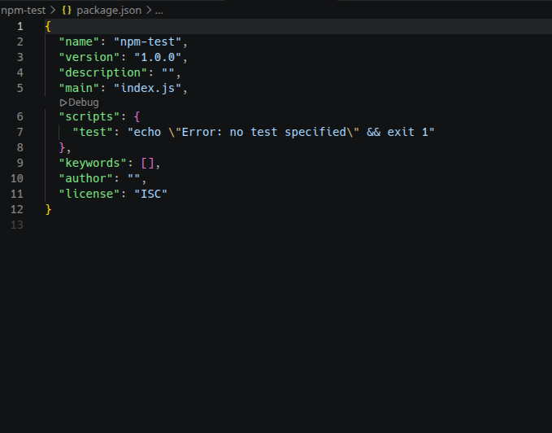
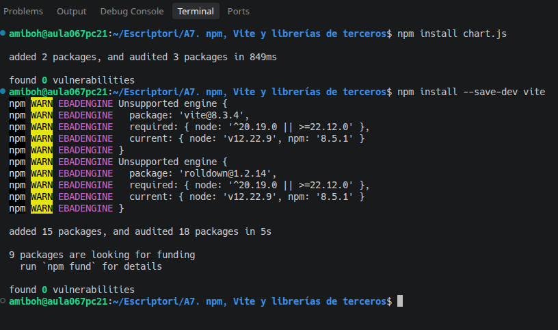
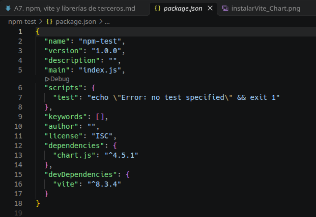
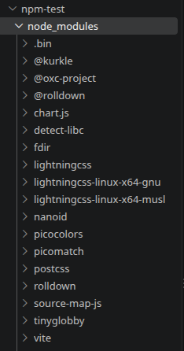
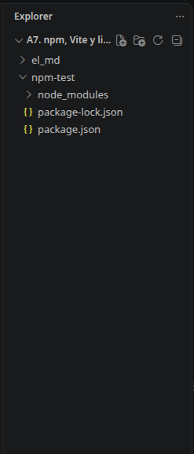

# A7. npm, Vite y librerías de terceros
## 1. Node.js y npm
### Diferencia:
- node es un entorno de ejecucion de javaScript fuera del navegador
- npm sinifica Node Package Model que sirve para instalar, actualizar y gestionar paquetes y dependencias de javaScript.

### ventages de utilizar paquetes de terceros:
- Ahorrar tiempo 
- Reutilizar codígo 
- Facilitar el desarrollo
- Reducir errores

## 2. Proyectos npm
1. git init

2. package.json antes de installar packetes

3. installar vite y chart 

4. packaje.json despues de installar packetes 

5. node_module 

6. Estructura del proyecto 

- La finalidad de los archivos y directorios generados y la diferencia entre los dos tipos de dependencias.
    - node_modules: los paquetes que ya están instalados 
    - dependencias: paquetes necesarios para el funcionamiento de la aplicación
    - devdependencias: herramientas utilizados durante el desarrollo, las pruebas o la compilación.

## 3. Crear el proyecto con Vite

